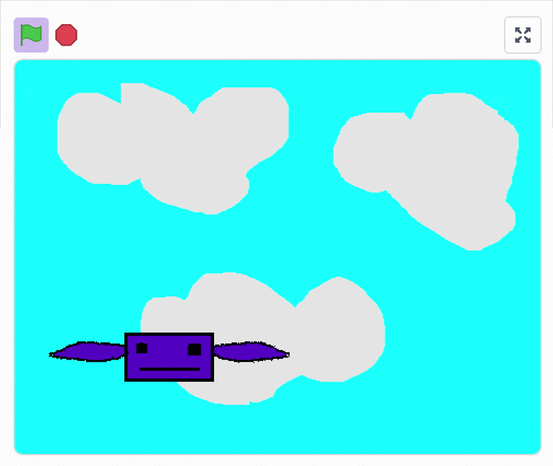

My first coding experience was building games in [Scratch](https://scratch.mit.edu/). I have so many fond memories of just sitting down and trying to translate ideas in my head into little blocks of code, drawing sprites pixel by pixel, and hitting the big green play button.

*One of the first things I created*

I enjoy a lot of aspects of programming. I enjoy solving hard problems, and the eureka moment of tracking down the source of a bug, and the feeling of coming up with a clean and orderly structure for an architectural diagram. But more than anything, I love creating.

Over the years, my process of creation has changed. It started with Scratch, then Python and PyGame, then websites deployed to Heroku in Ruby on Rails, Kotlin apps on Android, Vue and React websites deployed on EC2. The tools and frameworks are different, but the joy of creating is the same.

Now the year is 2026, and the process of creating has changed once again. I am no longer sifting through Stack Overflow, switching between files in VSCode, or trying to remember how to revert a git commit.

Instead, I talk to Claude Code - sometimes typing, sometimes literally with my voice. Together we brainstorm, make decisions, and then Claude brings my ideas to life. There are still constraints - actions I have to take manually, questions of taste, financial cost tradeoffs. But the process of creating has become nearly effortless. 

I miss some aspects of the programming world that is in the rearview, and I often wonder about what the future of programming holds with a mix of anticipation, exhileration, and a healthy amount of trepidation.

But more than anything, it just feels good to create. I no longer have to choose which project I want to devote my weekend too, or stay up late into the night trying to understand why my app won't compile. The moment I want to create something, I can create it. 

Some things I have had the joy of creating this year:
* A [Marathi textbook](https://tristrumtuttle.com/Marathi-for-English-Speakers-Textbook/) and flashcards
* Improved versions of my [previous social deduction games](https://github.com/triton11/MovieDate)
* An online escape room for a remote Easter celebration
* So many small tools for tracking finances, analyzing fantasy football rosters, and pretty much anything I can dream up
